# Enterprise Network Design: HQ and Branch (Cisco Packet Tracer)

A two-site enterprise network with VLAN segmentation, inter-VLAN routing, DHCP, OSPF and NAT/PAT, built and tested in Cisco Packet Tracer. HQ and the branch are connected through a simulated ISP router.

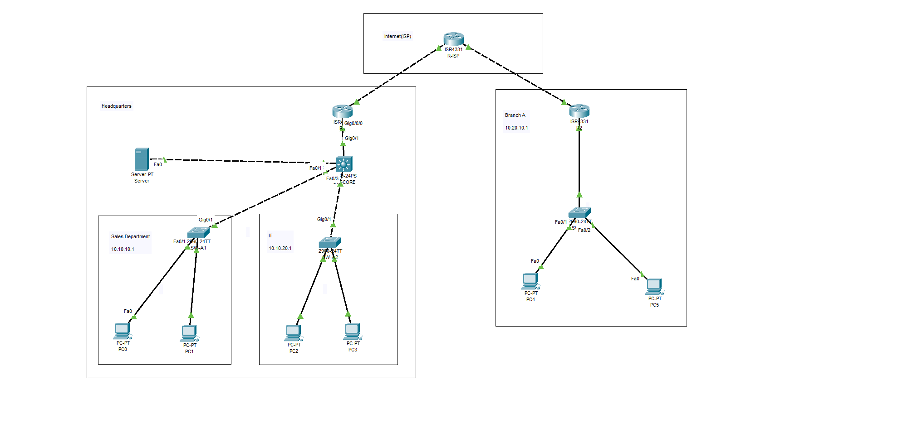

## Objectives

- Segment HQ into Sales (VLAN 10), IT (VLAN 20) and Management (VLAN 99) VLANs
- Route between VLANs with router-on-a-stick
- Assign addresses automatically with DHCP at both sites
- Connect HQ, the ISP and the branch with OSPF (area 0)
- Give both sites internet access with NAT/PAT, without translating site-to-site traffic
- Limit the number of devices on access ports with port security

## Tools and Devices

| Role | Device |
|---|---|
| Edge routers (R1, R2) and ISP router (R-ISP) | Cisco ISR4331 |
| Core switch (SW-CORE) | Cisco 3560 |
| Access switches (SW-A1, SW-A2, SW-B1) | Cisco 2960 |
| End devices | PCs and a server |

Software: Cisco Packet Tracer (version: _add your version_).

## Topology Summary

| Site | Devices |
|---|---|
| HQ | R1 (edge router), SW-CORE, SW-A1 (Sales), SW-A2 (IT) |
| ISP | R-ISP, with loopback 8.8.8.8/32 to simulate a public destination |
| Branch | R2 (edge router), SW-B1 |

### Links

| From | To | Type |
|---|---|---|
| R1 g0/0/0 | SW-CORE g0/1 | 802.1Q trunk (VLANs 10, 20, 99) |
| SW-CORE f0/2 and f0/3 | SW-A1 g0/1 and SW-A2 g0/1 | 802.1Q trunks |
| SW-CORE f0/1 | Internal server | Access, VLAN 99 |
| R1 g0/0/1 | R-ISP g0/0/0 | Routed link, 203.0.113.0/30 |
| R-ISP g0/0/1 | R2 g0/0/0 | Routed link, 172.16.12.0/30 |
| R2 g0/0/1 | SW-B1 | Branch LAN, 10.20.10.0/24 |

## IP Addressing

| Network | Subnet | Gateway | Notes |
|---|---|---|---|
| VLAN 10 Sales | 10.10.10.0/24 | 10.10.10.1 (R1 g0/0/0.10) | DHCP, SW-A1 ports f0/1-2 |
| VLAN 20 IT | 10.10.20.0/24 | 10.10.20.1 (R1 g0/0/0.20) | DHCP, SW-A2 ports f0/1-2 |
| VLAN 99 Management | 10.10.99.0/24 | 10.10.99.1 (R1 g0/0/0.99) | Internal server |
| Branch LAN | 10.20.10.0/24 | 10.20.10.1 (R2 g0/0/1) | DHCP from R2 |
| R1 to R-ISP | 203.0.113.0/30 | n/a | R1 .2, R-ISP .1 |
| R-ISP to R2 | 172.16.12.0/30 | n/a | R-ISP .1, R2 .2 |
| Simulated internet | 8.8.8.8/32 | n/a | Loopback on R-ISP |

## What I Configured

- **VLANs and trunking:** VLANs 10, 20 and 99 on the switches, with 802.1Q trunks between the core, the access switches and R1.
- **Inter-VLAN routing:** router-on-a-stick on R1, using one subinterface per VLAN.
- **DHCP:** address pools on R1 (Sales and IT) and R2 (branch), with the first addresses of each range excluded.
- **OSPF:** single area 0 across R1, R-ISP and R2. LAN-facing interfaces are passive, so hellos are not sent toward end devices.
- **NAT/PAT:** overload on both edge routers using the WAN interface address. An extended ACL exempts HQ-to-branch traffic, so site-to-site traffic keeps its real addresses.
- **Default routes:** each edge router sends unknown traffic to the ISP.
- **Port security:** access ports on SW-A1 and SW-A2 allow a maximum of 2 MAC addresses (default violation mode: shutdown).
- **Simulated internet:** a loopback (8.8.8.8/32) on R-ISP acts as a public destination for testing NAT.

## Verification

### VLANs and trunks (SW-CORE)

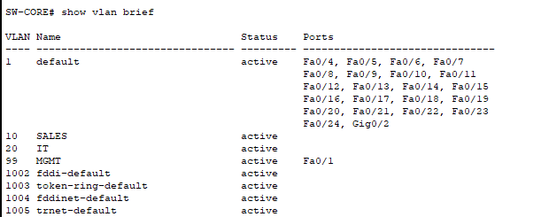

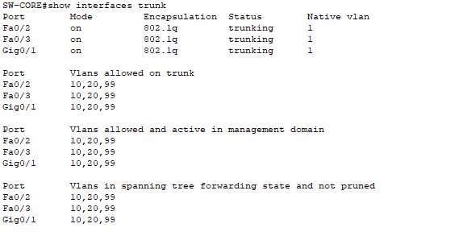

Trunks on Fa0/2, Fa0/3 and Gig0/1 carry VLANs 10, 20 and 99.

### DHCP (R1)

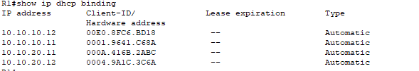

Sales PCs received 10.10.10.11-12 and IT PCs received 10.10.20.11-12.

### OSPF and routing

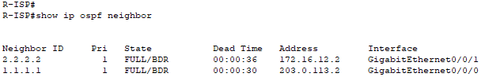

R-ISP has FULL adjacencies with both R1 (1.1.1.1) and R2 (2.2.2.2).

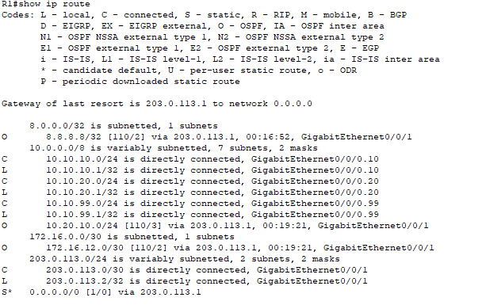

R1 learns the branch LAN (10.20.10.0/24), the R-ISP to R2 link and the simulated internet (8.8.8.8/32) through OSPF, and has a static default route to the ISP.

### NAT (R1)

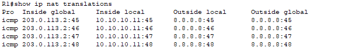

Sales PC 10.10.10.11 is translated to 203.0.113.2 when pinging 8.8.8.8.

### Connectivity tests

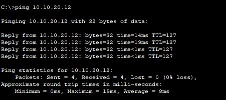

Sales PC to IT PC (inter-VLAN routing through R1).

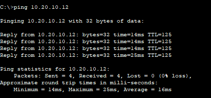

Sales PC to a branch PC across R1, R-ISP and R2 (TTL 125 confirms three router hops).

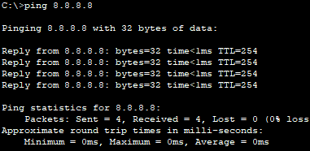

PC to the simulated internet address 8.8.8.8.

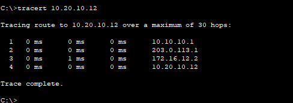

Path: 10.10.10.1 (R1) → 203.0.113.1 (R-ISP) → 172.16.12.2 (R2) → branch PC.

## Troubleshooting

1. **R1 uplink stayed down**
   - **Symptom:** the link to the ISP did not come up.
   - **Cause:** `show ip interface brief` showed g0/0/1 as unassigned and administratively down, because the uplink configuration had not been applied to that port.
   - **Fix:** assigned 203.0.113.2/30 and ran `no shutdown`, then confirmed up/up and tested with `ping 203.0.113.1`.

2. **Ping to 8.8.8.8 returned "Destination host unreachable"**
   - **Symptom:** replies came from 203.0.113.1 (R-ISP) saying the host was unreachable.
   - **Cause:** the traffic reached the ISP, but nothing existed at 8.8.8.8.
   - **Fix:** created a loopback with that address on R-ISP and advertised it in OSPF. The ping then succeeded and NAT entries appeared on R1.

3. **Cable would not connect to the expected router port**
   - **Symptom:** a cable could not be attached to a port named in my plan.
   - **Cause:** ISR4331 ports are named g0/0/0 to g0/0/2, not g0/0, g0/1 and g0/2 as on a 2911.
   - **Fix:** checked real port names with `show ip interface brief` and rebuilt the configs around them.

## Configs

All device configurations are in the [configs](configs/) folder, and the Packet Tracer file is `Enterprise-Network.pkt`.

## Lessons Learned

- Verify interface names and status first (`show ip interface brief`) before troubleshooting anything else.
- NAT needs a rule for traffic that should not be translated, otherwise site-to-site traffic is affected.
- Passive interfaces keep routing protocols off ports that only connect to end devices.

## Next Steps

- Add ACLs to control traffic between VLANs
- Harden management access (SSH, passwords, banners)
- Add redundancy (HSRP, EtherChannel)
- Connect the sites with a GRE or IPsec tunnel instead of sharing private routes through the ISP
